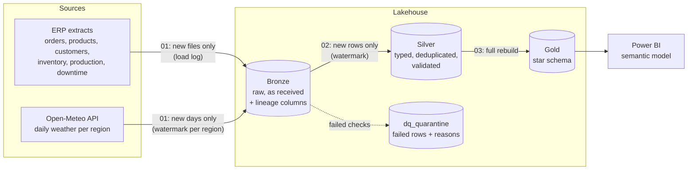

# Fabric medallion pipeline demo

[](https://github.com/lodeanalytics/fabric-medallion-demo/actions/workflows/test.yml)

An end-to-end Microsoft Fabric pipeline for **John Doe Foods**, a fictional food manufacturer and distributor. It takes raw ERP-style extracts and a public weather API through bronze, silver, and gold layers into a star schema ready for Power BI.

All data is fictional. The source files come from [demo-data-generator](https://github.com/lodeanalytics/demo-data-generator).

## Architecture



## Notebooks

| Notebook | What it does |
|---|---|
| [`00_utils`](notebooks/00_utils.ipynb) | Config and shared helpers: file listing, append, overwrite, and a Delta MERGE upsert. |
| [`01_bronze_ingest`](notebooks/01_bronze_ingest.ipynb) | Appends each new CSV to `bronze_<entity>` and logs it in `etl_load_log`, so no file loads twice. Pulls daily weather for five regions from the Open-Meteo archive, starting after the last date already loaded, with retry and backoff. |
| [`02_silver_transform`](notebooks/02_silver_transform.ipynb) | Processes only new bronze rows. Trims, deduplicates to the latest version of each key, casts types, and runs data-quality and referential checks. Failing rows go to `dq_quarantine` with the checks they broke; passing rows are upserted into `silver_<entity>`. Run counts go to `dq_results`. |
| [`03_gold_model`](notebooks/03_gold_model.ipynb) | Rebuilds the gold star schema from silver. |

### Gold tables

| Table | Grain | Notes |
|---|---|---|
| `dim_date` | day | Full calendar years covering the data |
| `dim_customer` | customer | Channel and region |
| `dim_product` | item | Product family, price, and standard cost |
| `fact_sales` | order line | Gross, discount, net, cost, and margin |
| `fact_production` | production run | Availability, performance, quality, and OEE, plus the additive parts behind them |
| `fact_inventory` | item per weekly snapshot | Available cases and days on hand from 28-day average demand |
| `fact_downtime` | downtime event | Reason and planned or unplanned |
| `fact_sales_weather_daily` | region per day | Net sales next to that day's high, low, and precipitation |

## Run it in Fabric

1. Create a workspace and a lakehouse. A trial capacity is fine.
2. Generate the data: `python generate_data.py --out ./2026-10-31` from [demo-data-generator](https://github.com/lodeanalytics/demo-data-generator).
3. In the lakehouse, upload that folder to `Files/landing/john_doe_foods/`, so the files sit in `Files/landing/john_doe_foods/2026-10-31/`.
4. Import the four notebooks (**Workspace > Import > Notebook > From this computer**) and attach the lakehouse to each one as its default.
5. Run `01_bronze_ingest`, then `02_silver_transform`, then `03_gold_model`.
6. To schedule it, add the three notebooks to a Data Pipeline as Notebook activities in that order, connected on success, with a failure path to an email or Teams alert.

To see the incremental behavior, drop a second dated folder (for example, a `products.csv` with a changed price) and run the three notebooks again. Only the new file is loaded, and the price is updated in place.

## Design notes

- **Bronze keeps everything as received.** CSV columns stay as text, with `_source_file`, `_batch_id`, and `_ingested_at` added, so any silver or gold number can be traced back to the file it came from.
- **Each layer is incremental and safe to re-run.** Bronze tracks loaded files in `etl_load_log` and writes each file's log entry right after the file lands. Weather uses a per-region date watermark. Silver uses a watermark on `_ingested_at`. Re-running with nothing new changes nothing.
- **Bad data is held back with a reason.** A value that won't cast is reported as a failed check rather than quietly becoming null. Each quarantined row keeps its original text, the checks it failed, and its source file.
- **Referential checks run in dependency order.** Products, customers, and orders are processed before the rows that point to them, so an order line for an unknown item is caught.
- **Downtime events have no source id**, so silver keys them on a hash of the full row.
- **OEE is stored as additive parts.** `fact_production` keeps planned minutes, run minutes, ideal cases, total cases, and good cases, so OEE rolls up correctly to any level in Power BI (sum of good cases / sum of ideal cases at planned time) instead of averaging percentages.
- **Gold is rebuilt in full** on every run. At this size that's fast and keeps gold exactly consistent with silver. A larger model would switch the facts to incremental MERGE.
- **Cost is the current standard cost** from the product table, applied to all history. A production model would keep cost history and join on the order date.

## Tests

[`tests/run_local.py`](tests/run_local.py) runs all four notebooks unchanged and checks the results:

- every source row reaches bronze and silver, and gold sales tie to silver
- re-running loads no file twice and makes no new weather calls
- a second delivery updates a product price in place (through a Delta MERGE) and adds a new order line
- a line with `cases = "abc"` and a line for an unknown product are quarantined and never reach gold

[GitHub Actions](.github/workflows/test.yml) runs it on every push with real Delta tables, on Spark 3.5 and Delta 3.2 (the versions in Fabric Runtime 1.3). Fabric's file utilities and the weather API are stubbed, and the weather stub returns fake values.

To run it yourself (needs Java 17+):

```bash
git clone https://github.com/lodeanalytics/demo-data-generator ../demo-data-generator
pip install pyspark==3.5.3 delta-spark==3.2.1 nbformat
USE_DELTA=1 python tests/run_local.py
```

Without `USE_DELTA=1` it runs on plain PySpark with no extra downloads, writing Parquet and swapping the MERGE for an equivalent anti-join and union.

## About

Built by Andrew at [Lode](https://lodeanalytics.com): Microsoft Fabric and Power BI data engineering for manufacturers and distributors.
